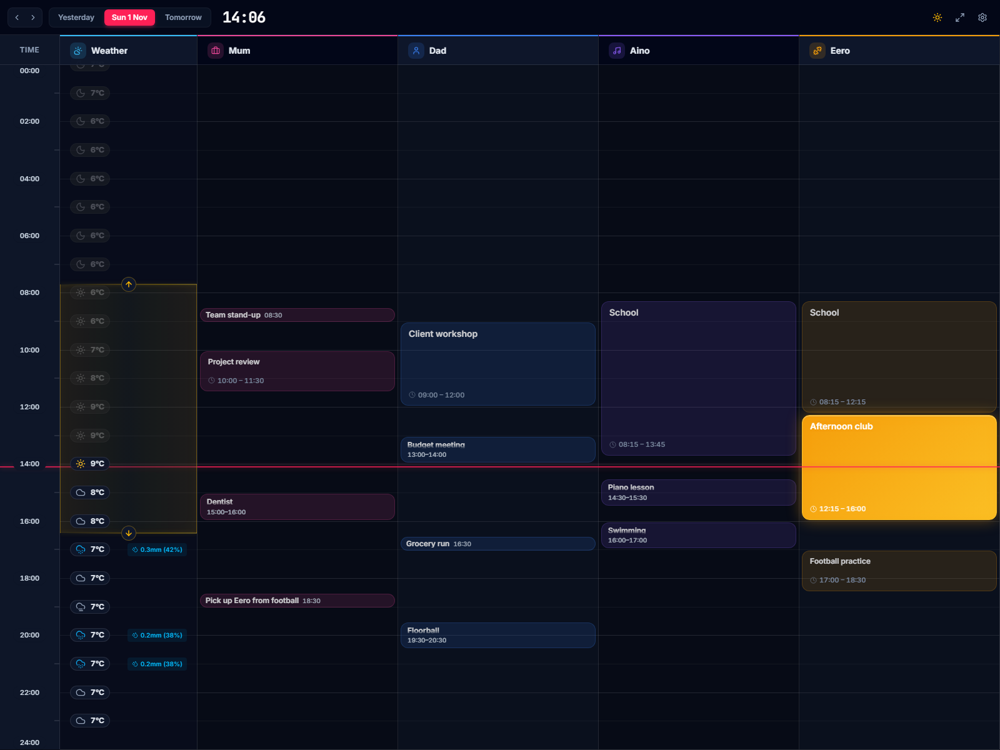
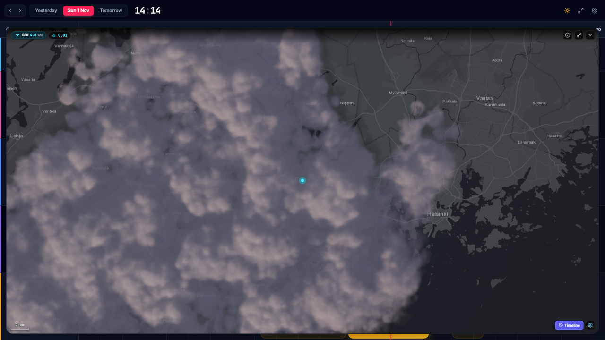
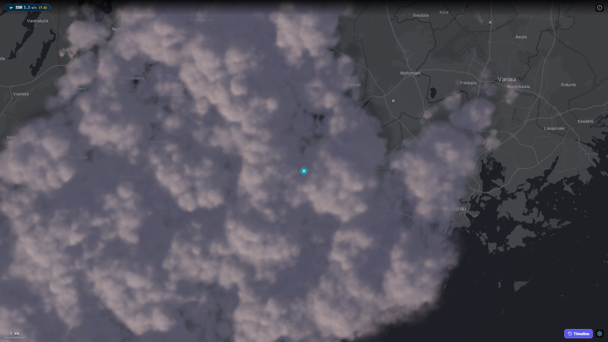
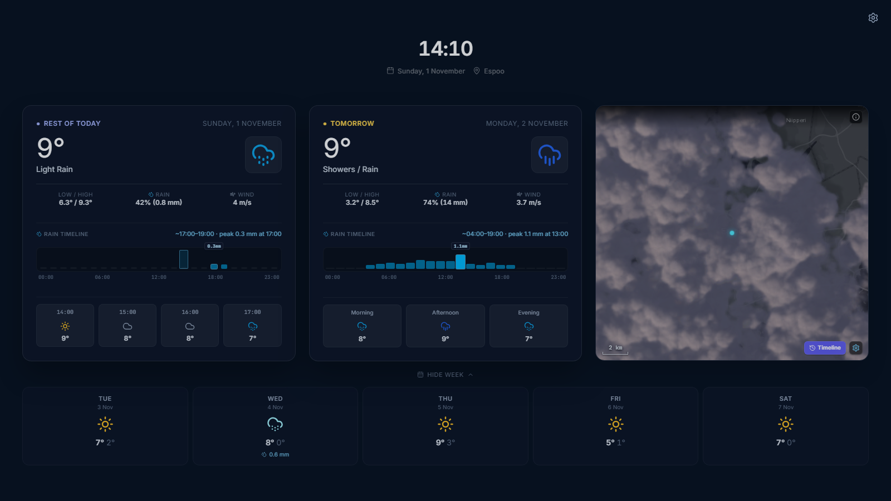

# Meanwhile

Meanwhile puts a family's day-to-day errands on one screen. It runs on a wall display in kiosk
mode. A kid walking past sees what they have on later today and whether it will rain. A parent sees
their own errands next to the kids' hobbies, and can tell at a glance whether someone will need a
lift home from football because the weather has turned miserable. See it live at
[meanwhile.lumikello.net](https://meanwhile.lumikello.net).



Beyond those everyday essentials, Meanwhile has a few extras it could do without but that are
nice to have:

- **Realistic clouds.** The live precipitation radar is drawn as procedural WebGL clouds drifting
  over the map, simply because it looks good.
- **Air traffic.** Live aircraft fly across the radar for no reason other than curiosity: I wonder
  where that plane is going?
- **Aurora alerts.** When the Kp forecast, darkness, and a clear sky line up, the night screen
  glows: there may be Northern Lights tonight, so step outside and see if you can spot them.

The radar and the aircraft only work in Finland: the weather data comes from the Finnish
Meteorological Institute, and the aircraft from a Finland-wide snapshot.



This repository also contains the weather and radar libraries behind Meanwhile, and two small
example apps that put them to other uses. All three apps are live:

| App | What it is | Live |
| --- | --- | --- |
| [Meanwhile](./apps/dashboard) | The family's day on a wall display: everyone's errands and hobbies, the weather, a live radar, and a night screen | [meanwhile.lumikello.net](https://meanwhile.lumikello.net) |
| [Weather&nbsp;Map](./apps/weather-map) | Example app: a full-window weather radar with live aircraft | [map.lumikello.net](https://map.lumikello.net) |
| [Weather&nbsp;Clock](./apps/weather-clock) | Example app: a calm, always-on clock and forecast display | [weather.lumikello.net](https://weather.lumikello.net) |

| Weather Map | Weather Clock |
| --- | --- |
|  |  |

Meanwhile needs no account and sends no telemetry, and its settings stay in your browser. There is
one catch on the public app: browsers can't fetch calendar feeds such as Google Calendar's secret
iCal links directly, so a lane that syncs from a calendar URL fetches it through a small relay on
Vercel. The relay stores nothing, but Vercel keeps request logs, and your calendar URL shows up in
them for up to 30 days. To keep your calendar entirely to yourself, either import a local `.ics`
file, which never leaves the browser, or run the whole app on your own machine from the multi-arch
Docker image (see [self-hosting](./apps/dashboard/SELF_HOSTING.md)), so the relay and its logs are
yours. [PRIVACY.md](./apps/dashboard/PRIVACY.md) has the full details.

## What's in the repository

```
apps/
  dashboard/        Meanwhile itself: React app, relays, self-hosted server, design and privacy docs
  weather-map/      example app built on the libraries (with its own aircraft relay)
  weather-clock/    example app built on the libraries
packages/           the @simon-lumikello/meanwhile-* libraries, as TypeScript source
  weather/          forecast models, providers (FMI, Open-Meteo, NOAA), queries, icons
  radar/            the radar scene: MapLibre map, WebGL clouds, nowcast, aircraft, lightning
  ambient/          the clock and forecast-card presentation of the night screen
  ui/               shared accessible controls and the app-version plugin
  relay/            server-side same-origin relays (live aircraft)
scripts/            the boundary check, library hygiene tests, README screenshots
docs/plans/         durable plans for multi-session work
docs/screenshots/   the README screenshots
```

Everything lives in one bun workspace with a single lockfile. The libraries are never built or
published. Each one's entry points point straight at its `src/`, and every app compiles them as
part of its own code, so a library change ships in the same pull request as the app code that
uses it. The [libraries README](./packages/README.md) shows how an app wires them in, and the two
example apps are the smallest complete examples.

## Getting started

All you need is [Bun](https://bun.sh); there are no tokens or private registries.

```bash
bun install
bun run dev                 # the dashboard on http://localhost:5173, with its relays
```

| Command | Purpose |
| --- | --- |
| `bun run dev`, `bun run dev:weather-map`, `bun run dev:weather-clock` | Start an app's dev server |
| `bun run build` | Type-check and build every app (`build:<app>` for one) |
| `bun test` | Unit tests for every app, library, and script |
| `bun check` | Type-check every project, including tests and browser suites |
| `bun run lint` | Lint with oxlint |
| `bun run check:boundaries` | Check library entry points, layering, and declared dependencies |
| `bun run test:<app>:e2e`, `bun run test:libraries:e2e` | Playwright browser suites against production builds |
| `bun run screenshots` | Retake the README screenshots from production builds, using a made-up family calendar and live weather |

## How it is built

Most of the work on this repository is done by AI coding agents. They are steered by files in the
repository rather than by long prompts:

- **Layered steering.** [AGENTS.md](./AGENTS.md) holds the workspace-wide rules (tooling, workflow,
  shipping, CI, and the engineering standard), and each app and the libraries add an `AGENTS.md`
  of their own with product rules. An agent reads the root file and the one next to the code it is
  changing. Beside each `AGENTS.md` sits a `CLAUDE.md` that imports it, so Claude Code picks up the
  same rules.
- **Checks instead of reminders.** Wherever a rule can be checked, something checks it.
  `check-boundaries` enforces the libraries' public entry points, layering, and declared
  dependencies. Hygiene tests guard against duplicate React and React Query instances and keep the
  Docker build and Tailwind sources in order. A docs test fails when a README or `AGENTS.md` names a
  script, link, or path that doesn't exist. And every TypeScript file, tests and browser suites
  included, is type-checked in strict mode.
- **The platform ships.** `main` takes changes only through pull requests whose CI passed, so
  shipping is opening a pull request with auto-merge on; GitHub merges it once CI is green, and
  Vercel deploys every app from `main`. Docker images are published only from GitHub releases.
- **Durable plans.** Work that spans several sessions keeps a plan in [docs/plans/](./docs/plans)
  with task IDs, acceptance criteria, evidence, and a resume record, so a fresh session can pick
  it up without the previous conversation.

## Deployment

Each app is its own Vercel project, deploying this repository from the app's directory with that
app's `apps/<app>/vercel.json`. The dashboard and weather-map also have Edge Functions in
`apps/<app>/api/`. Every merge to `main` deploys all three apps. The dashboard's Docker image is
published to `ghcr.io/simon-lumikello/meanwhile` with each GitHub release.

## License

[MIT](./LICENSE)
