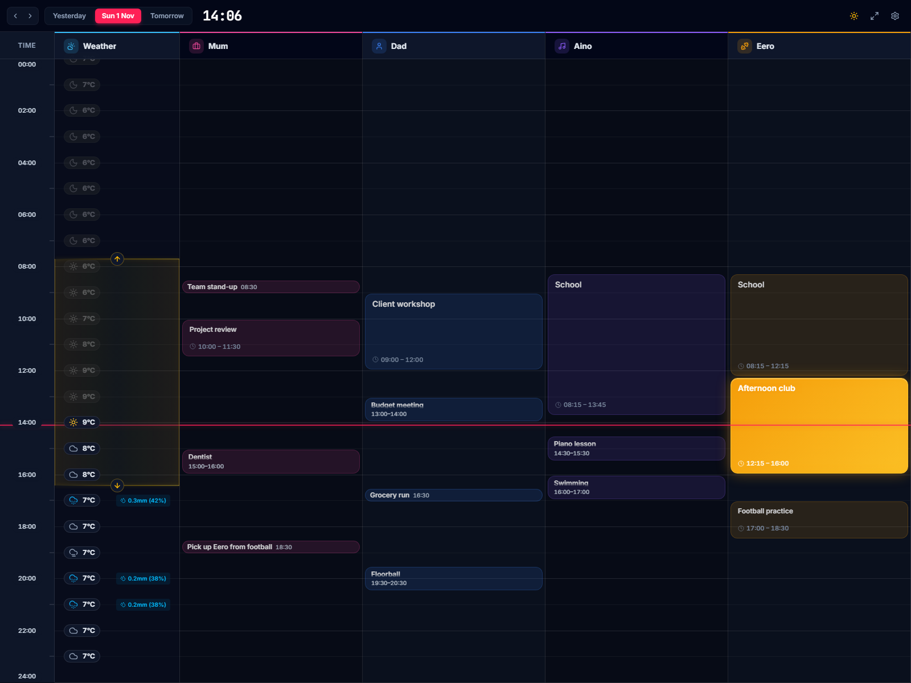
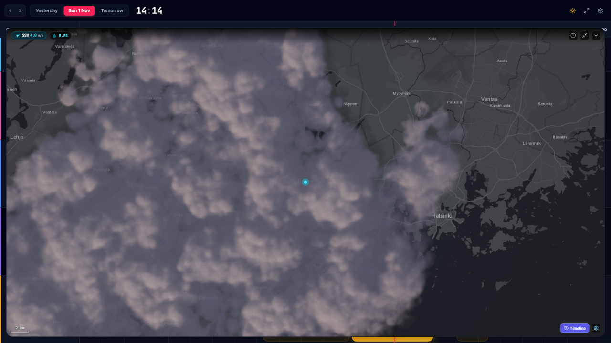
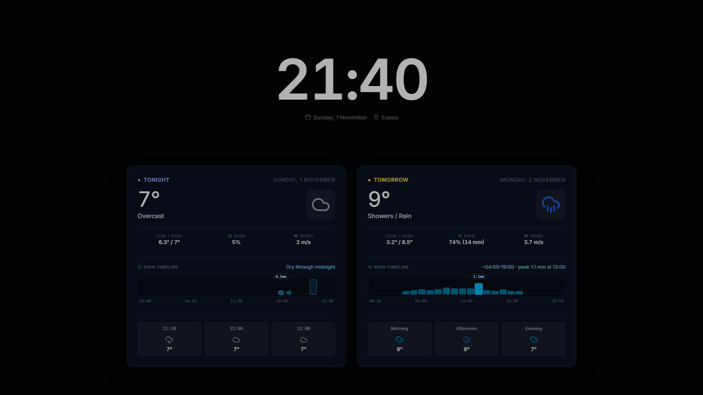

# Meanwhile

An everyday tool for running a family's errands, made for a wall display in kiosk mode. Each
family member has a lane across today, next to the hourly weather: kids can check what they have
later today and whether it will rain, and parents see their own errands beside the kids' hobbies,
and whether a rainy evening means picking someone up from practice. Live at
[meanwhile.lumikello.net](https://meanwhile.lumikello.net), also served at
[calendar.lumikello.net](https://calendar.lumikello.net).

It also does a few things nobody needs, because they are nice to have: rain on the radar renders
as realistic WebGL clouds, live aircraft cross the map for anyone wondering where that plane is
going, and the night screen lights up when an aurora may be visible tonight. These extras are made
for Finland: the radar comes from the Finnish Meteorological Institute and the aircraft from a
Finland-wide snapshot. Aurora alerts are worked out for the dashboard's own location.

| Radar | Night screen |
| --- | --- |
|  |  |

## Features

- **Calendar lanes:** each family member gets a colour-coded lane, fed by a Google Calendar
  secret iCal URL (refreshed automatically) or a local `.ics` file that never leaves the device.
- **Event details:** click any event for its details, or open it directly in Google Calendar.
- **Weather lane:** hourly forecast from the Finnish Meteorological Institute (FMI) or
  Open-Meteo, with a 24-hour precipitation timeline and window-aware dayparts. Below freezing,
  precipitation shows as snow or sleet.
- **Live weather radar and nowcast:** FMI precipitation radar on a key-free MapLibre map
  (wheel, pinch, and drag zoom, with clouds that stay attached to the ground), wind and rain
  readings, rain proximity alerts, live aircraft, and a short-term radar forecast. It renders as
  procedural WebGL clouds or radar blocks.
- **Aurora alerts:** NOAA's Kp forecast, dark-sky solar maths, and the local cloud forecast light
  up the night screen with a Northern Lights glow when an aurora is likely visible.
- **Night screen:** after hours or once the day's events end, an ambient screen shows a large
  clock, Tonight and Tomorrow forecast cards, an optional week ahead and radar card; any input
  wakes the dashboard.
- **Glanceable layout:** horizontal or vertical layouts, dark, light, or system theme, progress
  shown inside ongoing events, and an automatic return to today after two idle minutes.
- **No accounts, no telemetry:** no sign-up and no analytics; settings live in the browser's
  local storage.

## Privacy and the calendar relay

**Keep calendar data on your device:** export an `.ics` file from your calendar app, then choose
**Settings → Lanes → Calendar source → Local .ics file**, select the file, and press **Apply**. It
is parsed and saved only in your browser; it is never uploaded or sent through the calendar relay.
Re-import the file to update events. Configuration backups include imported events, so keep
backups private.

Google Calendar's secret iCal links cannot be fetched from a browser because of
[CORS](https://developer.mozilla.org/en-US/docs/Web/HTTP/CORS), so the hosted app routes iCal
requests through a small relay (`/api/ical-proxy`). Live aircraft on the radar use a second relay
(`/api/adsb-proxy`) for the same reason; [PRIVACY.md](./PRIVACY.md) says exactly what each sends.

The calendar relay receives your secret iCal URL, fetches the feed on your behalf, returns it, and
keeps nothing: no database, no logging of your data, and caching only for a few minutes. It
**could** read your events or keep your URL (which never expires), and you have no technical way to
verify that it doesn't unless you run it yourself. Vercel also [logs request
URLs](https://vercel.com/docs/observability/runtime-logs), including query strings, by default.

> **The honest recommendation:** use a local `.ics` file on the public app, or, for automatic sync
> through a relay you control, self-host: the pre-built Docker image runs on a home server or a
> Raspberry Pi, or deploy a copy to your own Vercel account. See [SELF_HOSTING.md](./SELF_HOSTING.md).

## Self-hosting

[SELF_HOSTING.md](./SELF_HOSTING.md) covers the multi-arch Docker image
(`ghcr.io/simon-lumikello/meanwhile`, for `amd64` and `arm64`), Docker Compose, a Vercel
copy of your own, and the local dev server.

## Development

From the repository root (see the root [README](../../README.md) for setup):

| Command | Purpose |
| --- | --- |
| `bun run dev` | Vite dev server, including the calendar proxy and aircraft relay |
| `bun run build:dashboard` | Type-check and build to `apps/dashboard/dist/` |
| `bun run build:server` | Bundle the self-hosted server (`server/index.ts`) into one dependency-free file |
| `bun test apps/dashboard` | Unit tests |
| `bun run test:dashboard:e2e` | Build, then run the functional Playwright suite |
| `bun run test:dashboard:ambient-controller` | The night-screen controller's browser suite (nightly in CI) |

The dev server runs both relays locally, so calendar URLs never leave your machine during
development.

## How it is built

| Part | Where |
| --- | --- |
| The app | `src/`: React, TanStack Query, Tailwind CSS; settings in `src/features/settings`, the timeline in `src/features/timeline` |
| Weather, radar, night screen, controls | The workspace libraries in [`packages/`](../../packages) |
| Calendar parsing | `src/services/icalParser.ts`: RFC 5545 with recurrence rules and overrides |
| Calendar proxy and aircraft relay | `server/`: one `Request` → `Response` handler each, served by the Vercel edge functions in [`api/`](./api), the Vite dev server, and the self-hosted server |
| Self-hosted server | `server/index.ts`, bundled into the Docker image ([`Dockerfile`](../../Dockerfile)) |
| Design notes | [DESIGN.md](./DESIGN.md): timeline coordinate maths, layout, and the design system |
