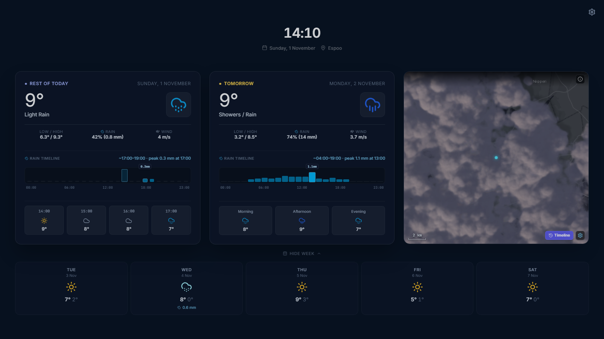

# Weather Clock

A calm, always-on weather display: a large clock and date above forecast cards, with an optional
live radar card, served at [weather.lumikello.net](https://weather.lumikello.net). Designed for
wall displays and spare screens; it stays on screen when touched or moved over, and keeps its
settings in this browser only. The clock shows the chosen location beside the date, and the radar
card zooms with the mouse wheel or a pinch, returning to its home view after two idle minutes.
NOAA's Kp forecast and the selected location's FMI sky conditions drive aurora indications on the
forecast cards and optional radar when nighttime visibility is likely, including a forecast for
tomorrow evening.

## An example app

weather-clock shows how a separate product is built on this repository's libraries. It is a
small React app that composes them and adds only its own settings:

| Library | What the app takes from it |
| --- | --- |
| [`@simon-lumikello/meanwhile-ambient`](../../packages/ambient) | The clock and forecast-card presentation |
| [`@simon-lumikello/meanwhile-weather`](../../packages/weather) | Forecast providers and queries, aurora evaluation |
| [`@simon-lumikello/meanwhile-radar`](../../packages/radar) | The radar card (`RadarViewport`) and FMI frames |
| [`@simon-lumikello/meanwhile-ui`](../../packages/ui) | Buttons, the settings dialog, and the new-version notice |

The wiring an app needs is all here: `workspace:*` dependencies in `package.json`, the library
stylesheets in `src/main.tsx`, Tailwind `@source` lines in `src/style.css`, and the MapLibre worker
plugin in `vite.config.ts`. The [libraries README](../../packages/README.md) explains each step.

## Development

From the repository root (see the root [README](../../README.md) for setup):

| Command | Purpose |
| --- | --- |
| `bun run dev:weather-clock` | Vite dev server |
| `bun run build:weather-clock` | Type-check and build to `apps/weather-clock/dist/` |
| `bun test apps/weather-clock` | Unit tests |
| `bun run test:weather-clock:e2e` | Build, then run the Playwright browser tests |

## Deployment

A static site: any host that serves `dist/` works. On Vercel, the `weather-clock` project builds
from this repository with Root Directory `apps/weather-clock` and its `vercel.json`. No
environment variables are needed.

## Privacy

The only analytics is Vercel Web Analytics on the hosted site: cookieless page-view counts, no
custom events. No tracking cookies or accounts. Settings stay in `localStorage`. Radar images cover
all of Finland, so they carry no location; the map loads basemap tiles for the area on screen from
Esri or OpenStreetMap, with no API key. Weather forecasts query FMI for the selected location. The
NOAA space-weather forecast is global and sends no location.
