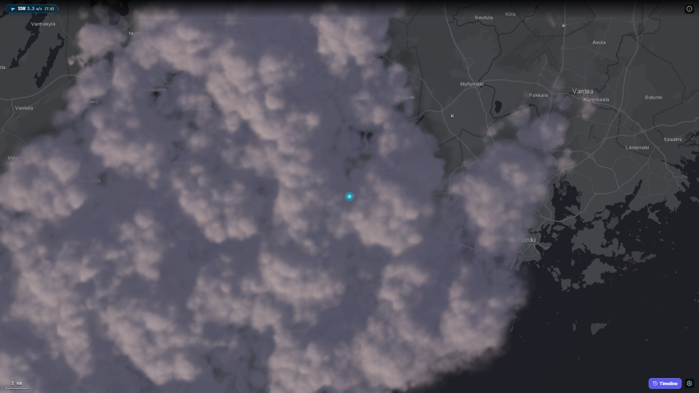

# Weather Map

A full-window weather radar with live aircraft, served at [map.lumikello.net](https://map.lumikello.net).
Choose a location; the radar fills the window and keeps its settings in this browser only. Zoom
with the mouse wheel or a pinch and drag to pan, like any web map; the clouds stay attached to the
ground while you zoom, and a scale in the corner shows distances. The header shows the current
wind and the radar's rain rate at the chosen location. When NOAA's Kp forecast and the location's
Open-Meteo sky conditions align at night, the map also shows an aurora badge and curtain overlay;
this works outside FMI radar coverage when weather data is available.

## An example app

weather-map shows how a separate product is built on this repository's libraries, including a
server-side part. It composes them and adds only its own settings:

| Library | What the app takes from it |
| --- | --- |
| [`@simon-lumikello/meanwhile-radar`](../../packages/radar) | The full-window `RadarViewport`, FMI frames, aircraft and lightning queries |
| [`@simon-lumikello/meanwhile-relay`](../../packages/relay) | The same-origin aircraft relay behind `/api/adsb-proxy` |
| [`@simon-lumikello/meanwhile-weather`](../../packages/weather) | Wind, rain rate, and aurora readings |
| [`@simon-lumikello/meanwhile-ui`](../../packages/ui) | Buttons, the settings dialog, and the new-version notice |

The wiring an app needs is all here: `workspace:*` dependencies in `package.json`, the radar
stylesheet in `src/main.tsx`, Tailwind `@source` lines in `src/style.css`, the MapLibre worker
plugin in `vite.config.ts`, and the relay in `server/aircraftRelay.ts` and `api/adsb-proxy.ts`.
The [libraries README](../../packages/README.md) explains each step.

## Development

From the repository root (see the root [README](../../README.md) for setup):

| Command | Purpose |
| --- | --- |
| `bun run dev:weather-map` | Vite dev server, including the aircraft relay |
| `bun run build:weather-map` | Type-check and build to `apps/weather-map/dist/` |
| `bun test apps/weather-map` | Unit tests |
| `bun run test:weather-map:e2e` | Build, then run the Playwright browser tests (the preview server serves the relay too) |

## Aircraft relay

ADS-B data cannot be fetched from the browser (the upstream sends no CORS headers), so the app
calls its own same-origin `/api/adsb-proxy`. It is served by `api/adsb-proxy.ts` as a Vercel Edge
Function in production, and by the Vite dev and preview servers locally, all from
`@simon-lumikello/meanwhile-relay` configured in `server/aircraftRelay.ts`. A static host without a relay
can build with an empty `VITE_AIRCRAFT_RELAY_URL`, which disables the aircraft overlay.

The app polls one Finland-wide snapshot every 30 seconds and the radar draws whatever part of it
is in view. Never make aircraft requests follow the map: per-view searches while zooming and
panning get the upstream to throttle (`429`).

## Deployment

On Vercel, the `weather-map` project builds from this repository with Root Directory
`apps/weather-map` and its `vercel.json`, which also deploys the relay's edge function. No
environment variables are needed.

## Privacy

The only analytics is Vercel Web Analytics on the hosted site: cookieless page-view counts, no
custom events. No tracking cookies or accounts. Settings stay in `localStorage`. The app asks its
aircraft relay for one shared snapshot of Finland (`?region=finland`), so no location leaves the
browser for aircraft; the relay forwards only fixed searches covering Finland and never stores
requests. Radar images cover all of Finland, so they carry no location; the map loads basemap
tiles for the area on screen from Esri or OpenStreetMap, with no API key. The wind and rain
readings ask Open-Meteo (current wind) and FMI (radar rain rate) directly from the browser, with
the chosen location's coordinates rounded to about a kilometre. Aurora visibility uses Open-Meteo
hourly weather at the selected coordinates; the NOAA space-weather forecast is global and sends no
location.
