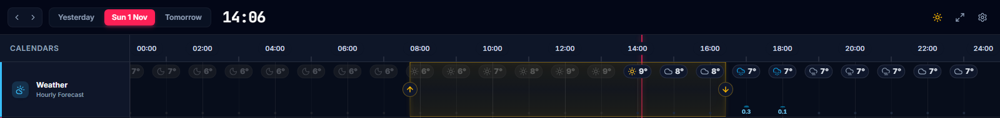
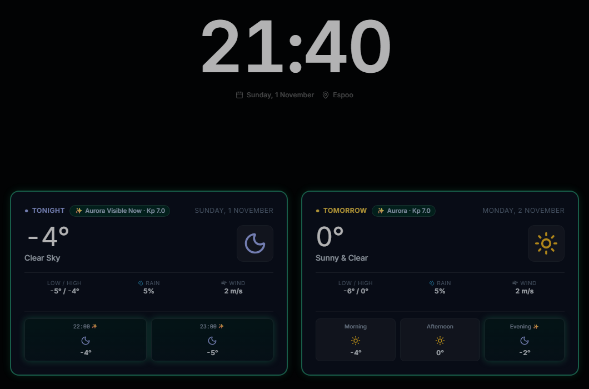
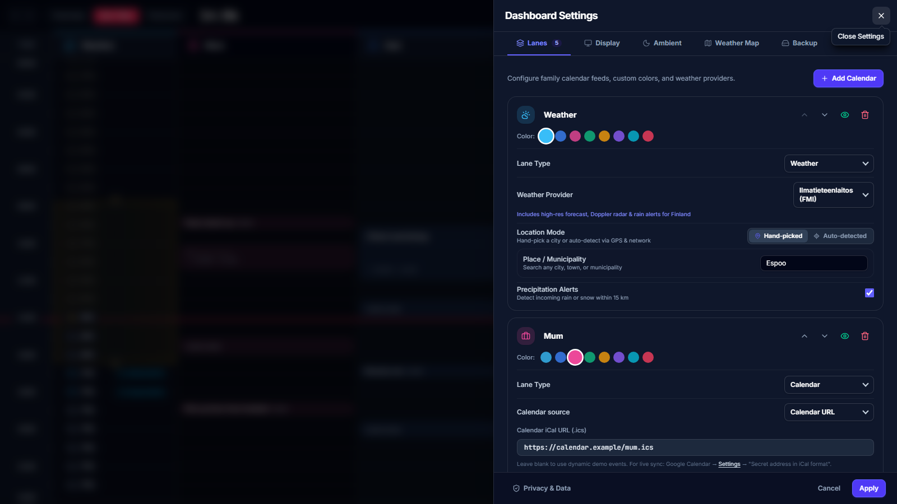

# Libraries

The reusable `@simon-lumikello/meanwhile-*` libraries. They are internal workspace packages of this
repository: apps import them by name, and each app's Vite build compiles their TypeScript source.
Nothing is built, versioned, or published, so a library change ships in the same pull request as
the app code that uses it. Rules for working on them: [AGENTS.md](./AGENTS.md).

| Package | Purpose |
| --- | --- |
| [`@simon-lumikello/meanwhile-weather`](./weather) | Forecast models, providers, queries, and weather presentation |
| [`@simon-lumikello/meanwhile-radar`](./radar) | Radar scene, sources, queries, and the MapLibre worker plugin |
| [`@simon-lumikello/meanwhile-ambient`](./ambient) | Ambient clock and forecast presentation |
| [`@simon-lumikello/meanwhile-ui`](./ui) | Shared accessible controls (buttons, dialogs, selects) and the app version plugin |
| [`@simon-lumikello/meanwhile-relay`](./relay) | Server-side same-origin relays (aircraft) |

| weather | radar |
| --- | --- |
|  |  |
| **ambient** | **ui** |
|  |  |

They are live in [Meanwhile](https://meanwhile.lumikello.net),
[Weather Map](https://map.lumikello.net), and [Weather Clock](https://weather.lumikello.net).

## Using the libraries in an app of this workspace

- Depend on each library with `"@simon-lumikello/meanwhile-<name>": "workspace:*"` and import only its
  exported subpaths (`@simon-lumikello/meanwhile-radar/core`, `…/react`, and so on).
- Import each package's stylesheet once where it has one
  (`@simon-lumikello/meanwhile-{weather,radar,ambient}/style.css`).
- `radar`, `ambient`, and `ui` components use Tailwind utility classes. Add each package you
  render to the app's Tailwind sources, or those utilities are silently missing:

  ```css
  @source "../../../packages/radar/src";
  @source "../../../packages/ambient/src";
  @source "../../../packages/ui/src";
  ```

- An app that renders radar registers the MapLibre worker plugin in its Vite config:

  ```ts
  import { maplibreWorkerSource } from '@simon-lumikello/meanwhile-radar/vite'
  export default defineConfig({ plugins: [react(), maplibreWorkerSource()] })
  ```

- React, React DOM, and TanStack Query are peer dependencies; the app owns the
  `QueryClientProvider`, settings, and storage.
- Aircraft data needs a same-origin relay built from `@simon-lumikello/meanwhile-relay` (see its README);
  pass its path as `relayUrl` to the radar aircraft query.

## Development

Run these from the repository root.

| Command | Purpose |
| --- | --- |
| `bun test` | Unit and hygiene tests for the libraries and the apps |
| `bun run check:boundaries` | Enforce entry points, layering, and declared dependencies |
| `bun run test:libraries:e2e` | Radar and ambient browser fixtures (production builds), as CI runs them |
| `bun --cwd=packages/radar run test:e2e` | The radar fixture against its dev server, for debugging (`packages/ambient` likewise) |
| `bun run test:radar:visual` | Cloud-rendering visual suite (Windows baselines; local only) |

Each library with UI keeps its browser fixture and Playwright suite in its own `e2e/` folder,
beside its unit tests in `tests/`.
