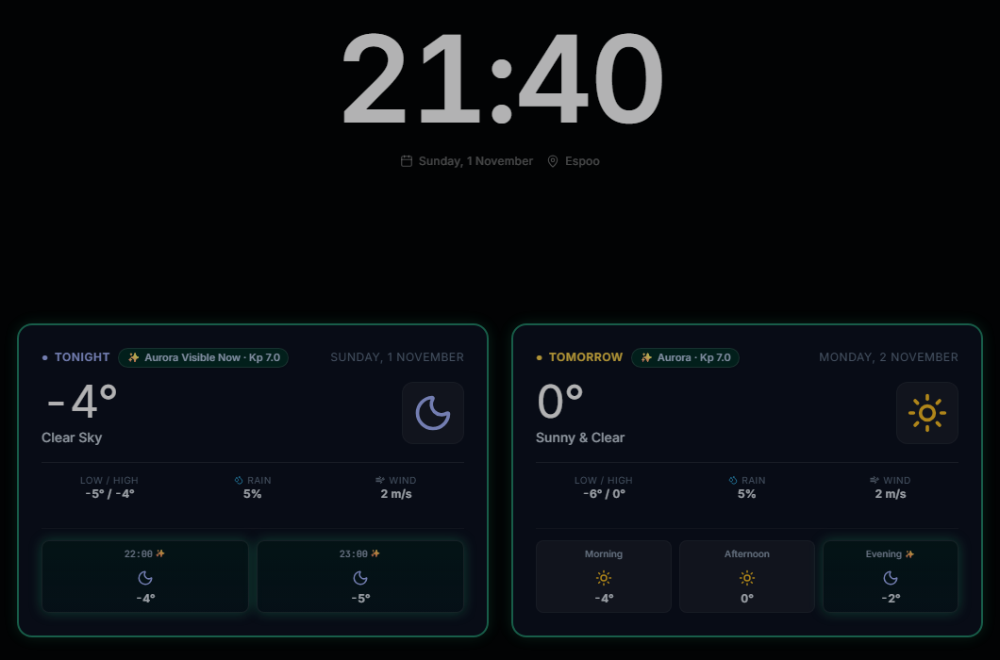

# @simon-lumikello/meanwhile-ambient

`@simon-lumikello/meanwhile-ambient` provides a persistent clock and forecast-card presentation. It does not install global listeners, own a query client, fetch data, or apply an idle/wake policy.



See it live as [Weather Clock](https://weather.lumikello.net) and as the night screen of
[Meanwhile](https://meanwhile.lumikello.net).

Install its isolated stylesheet once, then supply deterministic view data and an optional radar slot:

```tsx
import { AmbientView } from '@simon-lumikello/meanwhile-ambient/react'
import '@simon-lumikello/meanwhile-ambient/style.css'

<AmbientView
  currentTime={new Date()}
  location="Otaniemi"
  todayWeather={todayWeather}
  tomorrowWeather={tomorrowWeather}
  radarSlot={<MyRadarCard />}
/>
```

`AmbientView` decides where the radar goes and how big it is: a wide card below the
weather cards that grows into the free height when there is room, a third card in the
weather row on wide screens too short for that, or hidden when it would clip. Make the
slot's root element fill its box (`h-full`) rather than giving it a fixed height.

**Week ahead:** pass `weekForecast` (day summaries from the weather library's
`useWeekForecastQuery`) and `showWeek` to add a row of compact cards for the five days
after tomorrow. The row opens and closes with a staggered rise and fade, and the layout
rules above make room for it. Pass `onShowWeekChange` as well to show a subtle
**Week ahead** toggle under the cards; the host stores the choice. Omit the toggle where
any input dismisses the view (a lock screen) and offer the switch in settings instead.

The package expects React as a peer and depends on the public weather core/react entrypoints. It is safe to render without dashboard configuration or a query provider. Applications own data loading, lifecycle policy, fixed overlays, input handling, and radar construction.

**Aurora:** fetch NOAA Kp with the weather library's `useAuroraForecastQuery`,
evaluate it with `evaluateAuroraVisibility` using the selected location's hourly
weather and coordinates, and pass the result as `auroraStatus`. The view shows
current and tomorrow-evening badges with scoped glow styles. For a radar slot,
pass `auroraStatus.isCurrentlyVisible` and `auroraStatus.currentKp` to
`RadarViewport` as `hasActiveAurora` and `auroraKp` too.

`AmbientView` has no network or storage wiring. An embedding application uses its
own `QueryClientProvider` when fetching weather, passes forecast arrays to the
view, and controls clock updates and brightness policy. Import
`@simon-lumikello/meanwhile-ambient/style.css` once; it is scoped and does not reset the
host document. The supported target is a modern browser React host; manual
settings and display composition do not require secure-context browser APIs.

**Tailwind:** components use Tailwind utility classes, not `style.css`. Add the package's
source to the app's Tailwind sources (paths from `apps/<name>/src`),
or those utilities are silently missing:

```css
@source "../../../packages/ambient/src";
```

An internal workspace package of this repository: depend on it with `"workspace:*"`; apps
compile its TypeScript source (see the [libraries README](../README.md)).
