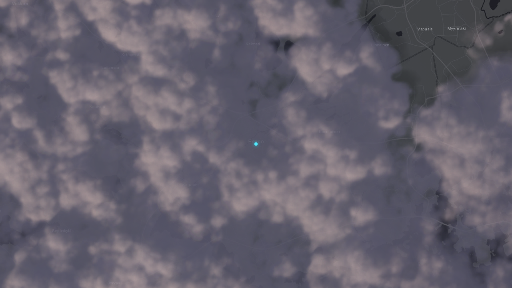

# @simon-lumikello/meanwhile-radar

A reusable radar scene, used by the Meanwhile dashboard and the weather-map and
weather-clock apps. It separates provider-independent projection and rendering from FMI,
wind, lightning, and optional aircraft adapters.

The viewport is a slippy map: wheel and pinch zoom anchored at the pointer, drag
with inertia, double-click zoom, and keyboard zoom, on
[MapLibre GL JS](https://maplibre.org/) (BSD-licensed, no API key). Basemap tiles
come from the same key-free Esri and OpenStreetMap servers as before.



See it live in [Weather Map](https://map.lumikello.net), the radar in
[Meanwhile](https://meanwhile.lumikello.net), and the radar card of
[Weather Clock](https://weather.lumikello.net).

## Installation

An internal workspace package of this repository: depend on it with `"workspace:*"`; apps
compile its TypeScript source (see the [libraries README](../README.md)).

## Usage

```typescript
import { RadarViewport } from '@simon-lumikello/meanwhile-radar/react'
import { createFmiRadarFrameSource } from '@simon-lumikello/meanwhile-radar/sources'
import '@simon-lumikello/meanwhile-radar/style.css'

// Create once (module scope or useMemo); frames reload only when its id changes.
const fmiRadar = createFmiRadarFrameSource()

<RadarViewport
  latitude={60.1695}
  longitude={24.9354}
  radarZoom="close"
  radarSource={fmiRadar}
  interactive
/>
```

`radarZoom` is the home view: the map opens there, eases back to it when the
location or preset changes, and, with `autoRecenterMs`, after a quiet period.
Free zooming and panning never change the host's setting. A map scale
(`showScale`, on by default) sits in the bottom-left corner in both rendering
styles, with the heatmap legend after it. The Timeline and Settings buttons share one row in the
bottom-right corner. The map credits sit behind an "i" in the header, just left
of `topRightSlot` (so a host's button keeps the corner), and open leftwards.
`onZoomChange` and `onCycleZoom` are deprecated and never called: there is no
zoom preset button.

Interactive maps gather the overlay choices behind one **Settings** button: a
dialog for the renderer (`renderMode`), the cloud filter (`filterMode`), and the
realistic clouds' `cloudTransparency` and `cloudLighting`. It edits a draft that
only **Apply** saves, then calls the matching `on…Change` callback for each value
that changed; leave a value and its callback out and the viewport keeps it
itself. `showRenderModeToggle`, `showFilterControl`,
`showCloudTransparencyControl`, and `showCloudLightingControl` choose which
sections the dialog offers. Non-interactive maps have no overlay controls or
badges; the scale bar shows the range.

An app with its own settings dialog can fold the map's choices into it, so it
has one settings UI rather than two. Pass `onOpenSettings`, and the map's
Settings button opens the app's dialog instead of its own. Put
`RadarSettingsFields` in that dialog: the same sections, controlled by a
`value` and `onChange` on the app's draft, saved by the app's own **Apply**.
Then pass the saved choices back to the viewport as props:

```tsx
import { RadarSettingsFields, RadarViewport } from '@simon-lumikello/meanwhile-radar/react'

<RadarViewport {...overlay} onOpenSettings={() => setSettingsOpen(true)} />

// Inside the app's settings dialog, beside its own fields:
<RadarSettingsFields value={draft.overlay} onChange={overlay => setDraft({ ...draft, overlay })} />
```

`cloudTransparency` (`'solid'`, `'sheer'`, or `'see-through'`; default
`'solid'`) makes the realistic clouds and their shadows translucent, so the map
stays visible under heavy weather. `cloudOpacity` (0–1, default 1) is an extra
factor on top. Both apply to `RadarViewport` and `LiveRadarMap`, and not to the
heatmap.

`cloudLighting` (`'time-of-day'` or `'noon'`; default `'time-of-day'`) decides
how the sun lights the realistic clouds: as it stands now, with sunrise and
sunset colours and moonlit nights, or always as at the day's solar noon (raised
to full daylight where the noon sun stays low).

The volumetric clouds interpret radar echoes as regional coverage. Scattered echoes
form broken puffs; widespread echoes merge into a continuous deck. Ground-anchored
procedural shapes supply the outlines, with precipitation adding thicker, darker
cloud in its measured neighbourhood. These are illustrative cloud shapes, not
measured cloud heights or a reconstruction of each radar pixel. Precipitation shades
the same cloud body instead of adding a separate deck. Both filters use that body; **Rain only** excludes the source's faint non-rain echoes.

With the interactive map focused, hold **Space** to compare the other rendering
style (heatmap or realistic clouds). Releasing Space or leaving map focus restores
the selected style without changing settings.

A `RadarFrameSource` is a georeferenced image provider: every frame covers one
fixed EPSG:3857 extent, and the viewport requests the latest scan (refreshed every
`radarRefreshMs`, five minutes by default) and playback scans itself. The FMI
source covers the whole Finnish composite in one image per scan, at about the
radar's native resolution, so zooming and panning never wait for the network.
`getFmiRadarMapUrl` remains for hosts that need a single bounded image.

### Timeline and forecast

Every interactive `RadarViewport` (and so `LiveRadarMap`) has a **Timeline**
button, so hosts need no wiring: it plays today's scans at once and, once it is
computed, a forecast after them (`forecastMinutes`, three hours by default; `0`
shows scans only). The forecast is prepared in the background as soon as the map
shows, redone every ten minutes (a hidden tab catches up when shown again), and
kept on screen while its replacement is computed; until the first one is ready
the timeline is a skeleton. The timeline always labels the frame on show: a
forecast frame in violet, with its lead time and clock time.
`showTimeline={false}` hides the button, `timelineTimestamps` replaces today's
scans (fixtures use it for fixed times), and the timeline closes itself after five
minutes without input. Play from Now starts an hour back, so the motion leading
into the forecast shows; the track is a keyboard- and drag-operable slider.

The forecast is a radar nowcast (`core`: `estimateRadarMotion`,
`nowcastDisplacements`, `renderNowcastFrame`). It finds the latest published scan,
measures how echoes moved over the hour before it by matching scans fifteen
minutes apart, and carries the latest scan forward along that motion, tracing
each pixel back along the flow so trajectories bend. Where the radar shows nothing
to track, and increasingly with lead time, motion follows the source's model
steering winds, turning as they are forecast to change; the frames blur slightly
as certainty fades. Echoes move but do not grow or decay. Work runs in short
slices between frames, and only while the timeline is open.

A source provides those winds with the optional `steeringWinds()` method. The FMI
source asks FMI's MEPS model for 700 hPa winds (`steeringLevelHpa`) at a small grid
of points around the location, from two hours before the latest scan to past the
forecast's end. Without model winds the forecast uses the radar's own motion and
the host's surface wind (`windSpeedMs`, `windDirectionDeg`), strengthened and
veered as the flow aloft usually is.

Apart from radar frames and steering winds, `RadarViewport` is data-only: hosts supply telemetry,
aircraft, and lightning. Query options and hooks are available from `@simon-lumikello/meanwhile-radar/query`.
Aircraft fetching is disabled unless the host passes an explicit `relayUrl` to
`useAircraftRegionQuery`, `useAircraftQuery`, or their query options; the package
never assumes a dashboard-relative relay route. Serve that route with `@simon-lumikello/meanwhile-relay`.

To show aircraft across whatever the map shows, use `useAircraftRegionQuery` with a
region the relay serves (such as `finland`). It polls one shared snapshot of the
whole region every 30 seconds, so zooming and panning never request anything,
and the renderer extrapolates each position from its real age in between: along
the reported turn (`track_rate`, or the rate the bank angle gives) for up to half a
minute, then straight. When the next snapshot disagrees with that guess, a small
miss glides into place over a few seconds; a large one (an aircraft that turned
sharply, typically near an airport) fades the aircraft in at its real position. A
throttled upstream (`429`) is not retried; the previous snapshot stays on screen.

```tsx
const aircraft = useAircraftRegionQuery('finland', { relayUrl: '/api/adsb-proxy' })
<RadarViewport latitude={lat} longitude={lon} airplanes={aircraft.data ?? []} />
```

`useAircraftQuery` still searches a radius around one point.

High-altitude jets leave contrails. Trails are kept in map coordinates, so they
keep their shape while the map zooms and pans. As they age they drift, widen,
ripple, and break into puffs before fading. When a new report corrects a small
miss, the trail laid since the previous report bends onto the straight line
between them as the aircraft glides over, instead of keeping a sideways step
where the glide was. A trail the aircraft has left behind,
because its position jumped or it is no longer shown, dissolves within a few
seconds instead of hanging where no aircraft is. The wind that moves them is an
upper-level estimate from the single surface reading passed as `windSpeedMs` /
`windDirectionDeg`, not a wind field: every trail in view drifts the same way, and
without a reading trails only widen and fade in place.

## Host wiring

`core` is safe without React or a QueryClient. `react` renders supplied scene
data, while `query` runs under the embedding application's `QueryClientProvider`.
React, React DOM, and TanStack Query are peers; weather core is the declared
runtime dependency. Source adapters use browser network APIs and an FMI frame may
be unavailable outside coverage. Embed the viewport in a measured container and
import `@simon-lumikello/meanwhile-radar/style.css` once; it is scoped and does not reset
host document styles.

**Vite:** the map engine loads on demand, with MapLibre's web worker bundled into its
chunk as a string. The host's Vite config provides it by registering the plugin from
`@simon-lumikello/meanwhile-radar/vite`: `plugins: [maplibreWorkerSource()]`. Without the plugin
the build cannot resolve `virtual:maplibre-worker-source`. Without WebGL the viewport
falls back to a fixed home view.

**Tailwind:** components use Tailwind utility classes, not `style.css`. The map controls
are `@simon-lumikello/meanwhile-ui` buttons, so add both packages' source to the app's Tailwind sources
(paths from `apps/<name>/src`),
or those utilities are silently missing:

```css
@source "../../../packages/radar/src";
@source "../../../packages/ui/src";
```

## Verification

`bun --cwd=packages/radar run test:e2e` starts a radar-only fixture
(`e2e/fixture`) with supplied frames and overlays; `test:e2e:production` runs
the same suite against a production build, as CI does. Neither
fixture needs dashboard configuration, a query provider, or external feeds.
`bun run test:radar:visual` renders `CloudRadarCanvas` against pixel-exact
baselines; they are Windows-rendered, so run it locally on Windows.

## Public entrypoints

- `@simon-lumikello/meanwhile-radar/core` — provider-independent projection, geometry, and display math.
- `@simon-lumikello/meanwhile-radar/sources` — FMI and optional aircraft source adapters with injected transport.
- `@simon-lumikello/meanwhile-radar/query` — TanStack Query options and hooks for active feeds.
- `@simon-lumikello/meanwhile-radar/react` — viewport and presentation components.
- `@simon-lumikello/meanwhile-radar/style.css` — isolated scene styles.
- `@simon-lumikello/meanwhile-radar/vite` — `maplibreWorkerSource()`, the Vite plugin every host registers.

## License

MIT License

## Seamless zoom

Every layer draws from one frame clock driven by the map's own render event, so
clouds, aircraft, lightning, and the home marker move in the same frame as the
basemap during wheel zoom and inertia. The cloud and storm shaders work in
ground coordinates: radar frames are sampled by map position, and procedural
detail uses zoom-continuous noise, in which every octave has a fixed ground
frequency and octaves fade in and out as the viewport grows or shrinks
(`src/worldNoise.ts`). Clouds therefore stay attached to the ground and never
pop, slide, or reload while zooming. Motion keeps the pace it was tuned at for
the `close` preset.

While the map is still, the clock runs without it and never makes the basemap
repaint: each layer draws at the frame rate it asks for (`setAnimating`), and a
requested redraw draws them all. Aircraft and lightning draw every display
frame; clouds far fewer (see `CLOUD_RENDER_POLICY`).

In the classic shader, the white clouds' billows and radar smoothing follow the
viewport, so they stay broad and fluffy at every zoom (the volumetric clouds below
read the white clouds over a fixed ground radius too). Rain and storm are the radar's measurement, so
they read the share of rainy radar cells within a fixed ground radius instead
(widened only when radar cells shrink to a few pixels): rain covers the ground the
heatmap shows in blue, from 0.2 mm/h, at every zoom, and a small shower never
swells into a solid deck when zoomed out. The billows only shade the rain, and its
edge frays into shreds over about a kilometre either side of the radar's.

## Volumetric clouds

Where WebGL2 is available, clouds are a volume raymarched from above and lit by the
real sun or moon, like cumulus seen from an aircraft: bright sunward faces, blue-grey
shaded flanks, light glowing through thin fringes, taller towers shading lower ones,
and cloud shadows on the map.

Around sunrise and sunset the light reddens through gold to pink and the shaded sides
turn violet. The colours vary across the view rather than tinting all cloud alike: the
sun's elevation is worked out for each point, so clouds on the sun's side stay golden
while the far side is already in twilight, and higher cloud sees the sun set later, so
tall towers keep their glow after low cloud has faded.

Where cloud is, and where its holes are, is decided on the ground: the radar is read
over fixed ground radii, like rain in the classic shader, so zooming never reshapes the
clouds. Domes then build their tops: rounded caps on grids anchored to the ground, each
size twice the last, stacked like a cauliflower, and pushing the edge into scallops. A
size fades in once its domes are a few pixels wide, so zooming in adds smaller domes to
the ones already there. A dome grows only as large as the cloud or rain across its own
width supports, so a small shower never carries the height of a dome sized by a wide
rain area. Billow noise carves the tops into puffs, calmly inside a cloud and
more deeply towards its edge, where it frays into translucent wisps. Clouds also fade out
to nothing at their edge over a few dozen screen pixels, broken up into wisps, so edges stay
as soft zoomed out, where the radar's edge spans only a few pixels, as they are close up. Rain
is the same cloud, lower, darker, and a little bluer: a lumpy deck under the white clouds
that shows between their domes, as far as the rain reaches. The white clouds thin their
domes over rain, and shade into it gradually: they darken and turn bluer over rain and,
fading out, for some distance around it. Storms raise the tallest towers.

Each frame renders in four passes (`src/volumetricClouds.ts`, `src/volumeShaders.ts`):
radar coverage over the viewport and a margin, at low resolution (sharing the classic
shader's radar sampling); the cloud tops over it; the raymarch at a fraction of the
canvas resolution, blended with the previous frame on the same ground to average away
sample grain; and the upscale onto the canvas. The billow noise is a tileable 3D texture
baked once on the GPU. Without WebGL2 (or half-float render targets) the classic shader
below draws the clouds.

## Owner cloud tuning

Edit [`src/cloudVisualTuning.ts`](src/cloudVisualTuning.ts). These controls compile into
the shader; they are intentionally separate from dashboard settings. Defaults retain
the established appearance. Reload the preview after changing them.

- `CLOUD_VOLUME_TUNING` shapes and lights the volumetric clouds: the white clouds' ground
  radius and edges (fraying, edge opacity, and the width in pixels they fade over), the
  dome sizes and heights, how deeply billows carve the tops, the rain
  deck, how opaque cloud is, sun, moon, and sky colours, the rain and storm tints and how
  far around rain they reach, and how long clouds take to boil. `clouds.evolutionSpeed` scales the boiling too.
- `CLOUD_RENDER_POLICY` sets the volumetric resolution (the raymarch's, the tops', and the
  coverage's share of the canvas), its step counts, how much of each frame is kept
  for the next, and the frame rate while the map is still: steady for a morph into a new
  scan or playback, and for boiling clouds falling as the map zooms out.

The settings below drive the classic shader, used without WebGL2:

- `clouds.evolutionSpeed` controls static-cloud boiling/breathing. Try `0.5` for slower
  evolution or `0` to freeze it; each deck's `boil` makes rain and storm churn faster
  still. Weather-frame playback remains independent.
- `clouds.envelopeWarpLarge` / `envelopeWarpSmall` control organic envelope displacement.
  Coverage, optical depth, opacity, and shadow controls adjust cloud body and contrast;
  the colour pairs set the white fair-weather clouds by day and night.
- Precipitation is shown by clouds rather than falling rain. White clouds sit at the
  back, a blue-grey `rain` deck over them, and a dark `storm` deck nearest the viewer,
  so the most severe weather is always the most visible. Each deck is built like the
  white clouds (its own fractal volume turned into optical density, so fluffy edges and
  holes) and casts a soft shadow on the layers beneath it in sun or moonlight. Each has moisture
  thresholds, coverage, billow scale, optical depth, opacity, cast shadow, and day/night
  colours. Moisture thresholds class each radar cell as rain or storm; a deck covers the
  ground where most cells within `precipitationRadius` ground meters are, so showers and
  rain bands show at their own extent, and frays across that radius at its edge;
  `precipitationEdgeWarp` lets the billows lobe the edge.
  Where the radar is wet, `deckVeil` keeps most of the deck in the hollows between its
  billows, so they shade the rain instead of opening holes in it. Moisture thresholds
  are renderer density, not a rainfall measurement. Keep threshold pairs ordered and
  opacity values in 0–1.

The heatmap draws each frame's own colors, except FMI's all-clouds `radar_rate` ramp. That
ramp shows light rain in nearly the same pastel as non-precipitating echoes, so the heatmap
redraws it in its own palette, tuned for dark maps: a faint cool-white mist for clouds, then
one ramp for rain from 0.2 mm/h, from sky blue through deep blue and violet to rose, coral,
and gold (`FMI_RATE_RAMP` in `src/cloudShaders.ts`; the legend follows it).

The classic shader keeps its diffusion kernel, noise detail, output resolution, and
animation cadence; the volumetric clouds trade resolution for volume and still draw
faster. Completed transitions skip the unused radar frame in cloud and shadow
sampling. Uniform locations are cached; resizing uses an observer; celestial lighting
refreshes on a short cadence and immediately after a location change. Hidden tabs stop
the animation loop, and playback resumes without consuming hidden elapsed time.

## Repeatable visual comparisons

From the repository root:

```sh
bun playwright test tests/cloud-rendering.spec.ts
```

The isolated browser fixture renders the production `CloudRadarCanvas` without live
weather or basemap requests, with a fixed camera over the captured extent. It fixes celestial time and advances animation manually.
Snapshots cover the configured location's captured radar, rain, zoom, wide layouts, themes, breathing, and
playback transitions. Resource and lifecycle checks cover steady frames, resize,
visibility, source replacement, failed images, unmount, and the static fallback.

Set the fixture's location name and coordinates in
[`e2e/clouds-fixture/fixture-config.ts`](./e2e/clouds-fixture/fixture-config.ts).
The current default is Ruka. This configuration also controls capture dimensions, zoom,
radar style, and fixed lighting time. The renderer and synthetic cell projection both
use the configured coordinates.

After changing the location, capture a matching real radar image:

```sh
bun packages/radar/e2e/clouds-fixture/capture.ts
```

This explicit capture step requires network access; normal visual tests remain offline.
It replaces `radar-capture.png` and
[`radar-capture.json`](./e2e/clouds-fixture/radar-capture.json), which records the
actual location, FMI GetMap source URL, capture date, bounds, and output resolution.
Tests reject mismatches between configuration and capture metadata so a previous
location's image cannot silently stand in for the new one. Inspect the captured image
for useful weather coverage, then review and update the snapshots as described below.

The unaltered captured observation is the realism anchor. Supplemental synthetic rain
uses quantized palette cells at approximately kilometre ground spacing, converted
to Web Mercator at the configured latitude and rasterized at each requested output resolution.
It includes transparent gaps and neutral no-data areas. It is not a meteorological
simulation and must not replace review against the captured raster.

For intentional art-direction changes, inspect Playwright's expected/actual/diff
images before accepting new baselines:

```sh
bun playwright test tests/cloud-rendering.spec.ts --update-snapshots
```

Comparisons are pixel-exact in the same Chromium/GPU environment; snapshots are
platform-specific. A different graphics backend may require separately reviewed
baselines. Do not loosen tolerances to hide changes in cloud structure.

For optional frame-cost measurements in PowerShell:

```powershell
$env:CLOUD_BENCHMARK = '1'
bun playwright test tests/cloud-rendering.spec.ts -g 'captured radar clouds' --reporter=html
Remove-Item Env:CLOUD_BENCHMARK
```

The test attaches median and tail timings as JSON. A tiny pixel readback forces GPU
completion; measurements include that synchronization overhead and exclude PNG encoding.
Compare on the same machine/backend. These are diagnostic timings, not display FPS.
