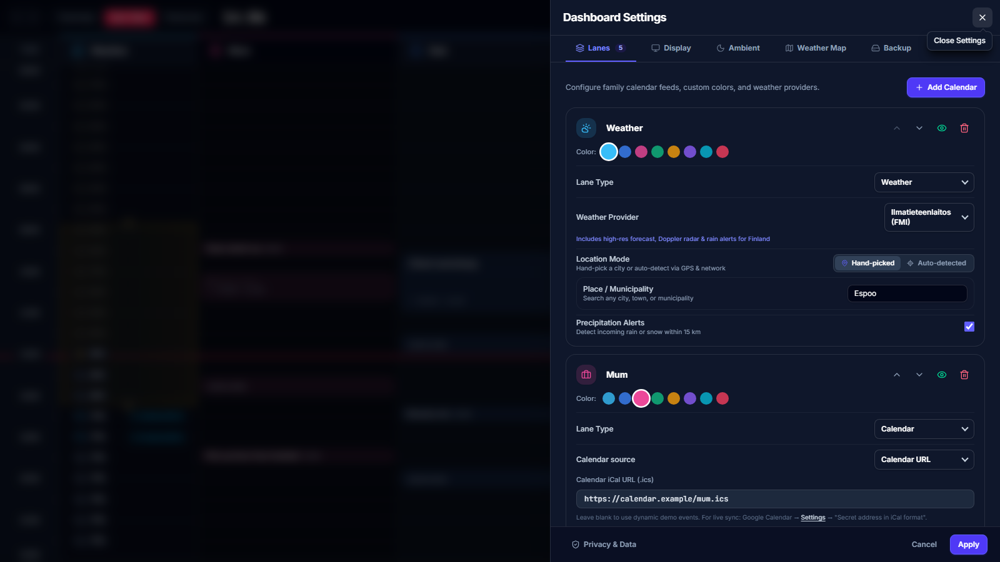

# @simon-lumikello/meanwhile-ui

Small reusable presentation controls shared by the `@simon-lumikello/meanwhile-*` libraries and the applications built on them.
Consumers retain ownership of their configuration state and persistence.



Every dialog and button in [Meanwhile](https://meanwhile.lumikello.net),
[Weather Map](https://map.lumikello.net), and [Weather Clock](https://weather.lumikello.net) comes
from this package.

`@simon-lumikello/meanwhile-ui/react` exposes:

- **`Button`** — `size` (`sm`, `md`, `lg`), `tone` (`primary`, `neutral`, `sky`, `cyan`,
  `purple`, `warning`, `danger`), and `variant`: `solid`, `soft` (tinted), `ghost` (borderless until
  hovered), or `overlay` (dark glass for controls drawn over maps and imagery, identical
  in light and dark themes). `icon` and `iconEnd` place icons around the label, sized to
  the button. `hideLabel` shows only the icon in a square button while the label stays
  the accessible name and tooltip; without children the button is square too and needs
  an `aria-label`. `pill` rounds its ends and `fullWidth` stretches it.
- **`buttonClassName(options)`** — the same classes for a link or a non-interactive
  badge (`inert: true`) that must look like a button.
- **`Dialog`** — a modal card (`placement="center"`) or side drawer (`placement="end"`)
  with a title, optional eyebrow, description, icon, and a footer that stays visible
  while the body scrolls. It closes on Escape, on its close button, and on a click
  outside the panel; it moves focus into the panel, keeps Tab inside it, and returns
  focus to the opener. Dialogs opened later stack above earlier ones, and only the
  topmost reacts to Escape. Controls inside it that use Escape themselves (an open
  listbox, an autocomplete) call `preventDefault()` to keep the dialog open.
  The dialog only presents; a settings dialog keeps its edits in a draft and saves
  them from its own Apply button.
- **`LocationSearch`** — a place-name combobox. The host runs the search (for example
  `useLocationSearchQuery` from `@simon-lumikello/meanwhile-weather/query`) with the text
  `onSearch` reports once typing pauses, and passes `results`, `isLoading`, and
  `isError` back; `onSelect` receives the chosen result. Arrow keys and Enter pick a
  suggestion, and Escape closes the list without closing an enclosing dialog.
  `formatLocationOption` gives the "Name, Region, Country" label.
- **`SettingsSelect`** — an accessible settings listbox. It closes when focus leaves it
  and claims Escape while open.
- **`AppUpdateNotice`** / **`useAppUpdate`** — notice a newer deployment. Add
  `appVersion()` from `@simon-lumikello/meanwhile-ui/vite` to the app's Vite plugins (it stamps
  the page and emits `version.json`), mount `<AppUpdateNotice />` under the
  `QueryClientProvider`, and serve `version.json` and `index.html` uncached. The notice
  checks every few minutes and on window focus, offers a Reload button, and reloads by
  itself after a quiet period so wall displays follow releases. It stays silent on the
  dev server.

**Theming:** components style dark mode with Tailwind's `dark:` variant. An application
with its own theme switch declares a class-based variant and sets `.dark` on an ancestor
(dialogs render in place, not in a portal, so they inherit it):

```css
@custom-variant dark (&:where(.dark, .dark *));
```

**Tailwind:** components use Tailwind utility classes, not `style.css`. Add the package's
source to the app's Tailwind sources (paths from `apps/<name>/src`),
or those utilities are silently missing:

```css
@source "../../../packages/ui/src";
```

An internal workspace package of this repository: depend on it with `"workspace:*"`; apps
compile its TypeScript source (see the [libraries README](../README.md)).
