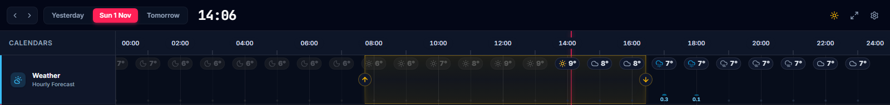

# @simon-lumikello/meanwhile-weather

A reusable weather library with deliberately small public entrypoints. The root
entrypoint is core-only and does not load transport or React code.



See it live in [Meanwhile](https://meanwhile.lumikello.net) (the weather lane) and
[Weather Clock](https://weather.lumikello.net) (the forecast cards).

## Installation

An internal workspace package of this repository: depend on it with `"workspace:*"`; apps
compile its TypeScript source (see the [libraries README](../README.md)).

## Usage

```typescript
import { evaluateAuroraVisibility, getSolarTimes } from '@simon-lumikello/meanwhile-weather/core'
import { getWeatherProvider } from '@simon-lumikello/meanwhile-weather/providers'
import { useAuroraForecastQuery, useLocationSearchQuery, useWeatherForecastQuery } from '@simon-lumikello/meanwhile-weather/query'
import { renderWeatherIcon } from '@simon-lumikello/meanwhile-weather/react'
import '@simon-lumikello/meanwhile-weather/style.css'
```

`core` contains weather models, forecast transformations, solar/celestial
calculations, and pure aurora evaluation. `providers` contains FMI, Open-Meteo,
NOAA, and location transports; requests accept injected transport, cancellation,
and clock inputs where applicable. `query` supplies TanStack Query options and
hooks with forecast refresh and aurora freshness defaults, a week outlook
(`useWeekForecastQuery`: one summary per day, from FMI's meteorologist-edited
forecast or Open-Meteo's hourly week), plus place-name
suggestions (`useLocationSearchQuery`) for `@simon-lumikello/meanwhile-ui`'s `LocationSearch`. `react` contains
portable icon presentation, and its explicit stylesheet supplies only icon
classes—no reset, Tailwind utility generation, or host-page styles. React,
React DOM, and TanStack Query are peer dependencies. Applications provide their
own query client, configuration, storage, and cross-domain composition.

All imports resolve to the package's built ESM, declaration, and stylesheet
artifacts. The root and `core` entrypoints remain safe for consumers that do not
load React or TanStack Query.

## Host wiring

Wrap `useWeatherForecastQuery` and `useAuroraForecastQuery` in the embedding
application's own `QueryClientProvider`, then pass an explicit provider and
coordinates/configuration to the forecast hook. Provider adapters use browser
network APIs; manual coordinates do not need geolocation or a secure context.
The package never creates storage, a query client, or an application relay.
Import `@simon-lumikello/meanwhile-weather/style.css` once when using React presentation;
it is scoped and does not reset the host page.

## License

MIT License
